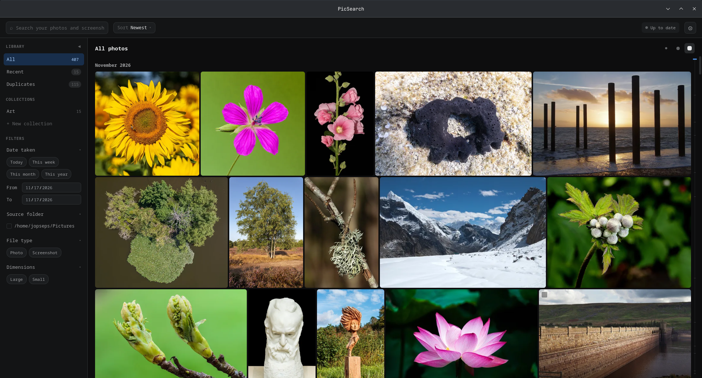
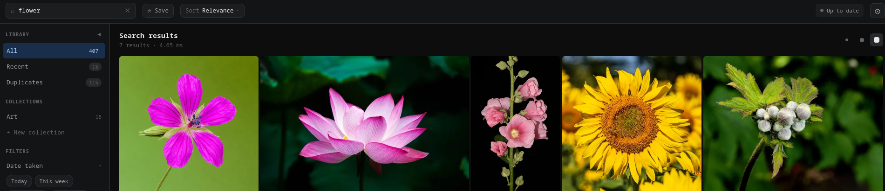

# PicSearch

Local semantic search over your own photos and screenshots. Point it at folders, and it makes them searchable by what is *in* them — type `table`, `dark code editor`, or `masa` and get the matching images back.

Runs entirely on your machine. No cloud, no account, no telemetry. Images never leave the computer they are on.





- **Semantic image search** — SigLIP 2 embeddings computed on your GPU
- **Text inside screenshots** — an OCR pass makes printed words searchable, fused with visual similarity
- **English and Turkish** — multilingual model and `tur+eng` OCR by default
- **Find visually similar** — from any photo, or by dropping an image onto the window
- **Swappable models** — change the embedding model and search keeps working while the library re-embeds
- **Filters, collections, saved searches** — a saved search restores its filters, not just its words
- **Stays in sync** — watched folders update live; deleting in the app moves the file to the system trash
- **Near-duplicate detection** — perceptual hashing, so two photos of the same thing group and two screenshots of the same app do not

## Install

Grab the file for your system from the [latest release](https://github.com/Jopseps/pic_embedding_search/releases/latest).

| System | File | How |
|---|---|---|
| Arch | `PKGBUILD` | put it in an empty folder, run `makepkg -si` |
| Debian / Ubuntu | `PicSearch_*_amd64.deb` | `sudo apt install ./PicSearch_*_amd64.deb` |
| Any Linux | `PicSearch_*_amd64.AppImage` | `chmod +x` it and double-click |
| Windows 10/11 | `PicSearch_*_x64-setup.exe` | run it — see *Unsigned* below |

**The first launch sets itself up.** The packages are small (~25 MB) because they carry the Python source, not PyTorch. On first start PicSearch downloads Python, PyTorch and the search model into your user folder, showing progress as it goes:

- with an NVIDIA GPU (driver 580+): CUDA PyTorch, about 3 GB plus 1.5 GB of model weights
- without one: CPU PyTorch, a few hundred MB plus the weights — indexing is roughly 20× slower

After that it starts in a second and never touches the network again. If setup ever breaks, the error screen has a **Reinstall environment** button; the environment lives in `~/.local/share/pic-search/runtime` (Windows: `%LOCALAPPDATA%\pic-search\runtime`) and deleting it is always safe.

**Text inside screenshots needs Tesseract**, which is a system program. The Arch and Debian packages pull it in; elsewhere install it yourself — Settings → *Text in images* tells you the exact command when it is missing:

- Arch: `sudo pacman -S tesseract tesseract-data-eng tesseract-data-tur`
- Debian/Ubuntu: `sudo apt install tesseract-ocr tesseract-ocr-eng tesseract-ocr-tur`
- Windows: `winget install UB-Mannheim.TesseractOCR` and tick *Turkish* in the installer

Without it everything else works; screenshots are just not searchable by their words.

**Unsigned.** Neither package is code-signed. Windows SmartScreen says "Windows protected your PC" — click *More info → Run anyway*. macOS is not packaged yet.

## Build it yourself

One command from a fresh clone. It checks the toolchain (and says how to install what is missing), runs `npm ci`, runs the frontend and sidecar tests, builds the packages and copies them into `release/` with a `SHA256SUMS`:

```bash
scripts/build-linux.sh           # Linux: .deb (+ .AppImage off Arch)
scripts\build-windows.cmd        # Windows: NSIS setup .exe; double-clicking works too
```

`--skip-tests` / `-SkipTests` and `--skip-install` / `-SkipInstall` cut steps; any other argument goes to `tauri build` (`--bundles deb`). The sidecar tests run in their own CPU-torch environment, `sidecar/.venv-build`, so the build never touches a dev `.venv`.

Or just the packaging step:

```bash
npm install
npm run package          # fetches a pinned uv, then tauri build
```

On Arch this builds the `.deb` only; `packaging/arch/PKGBUILD` repackages it (`PICSEARCH_DEB=<path to .deb> makepkg -si`). AppImages are built by CI on Ubuntu 22.04 — one built on a rolling distro links against a glibc too new for everyone else. Pushing a `v*` tag builds every package and attaches them to a draft release (`.github/workflows/release.yml`).

## Run it from source

```bash
npm install
cd sidecar && uv sync && cd ..    # torch + CUDA wheels, ~3 GB
npm run doctor                    # check the machine has what it needs
npm run tauri dev                 # desktop app, your own photos
```

`npm run doctor` is the first thing to run when something looks wrong. Missing Tesseract, missing Turkish language data, torch quietly on the CPU, a config naming an engine that is not installed, no watched folders — all of those show up in the app as the same empty grid and none of them announce themselves. It prints each one with the command that fixes it, loads no model, spawns no server, and changes nothing.

The desktop shell starts the Python sidecar, picks up its port and token, and talks to it over loopback. Add a folder in Settings and indexing begins — roughly 10 images/second on an RTX 4070 laptop GPU, thumbnails included. Screenshots are then read by OCR at about 1.3/second on the CPU, in parallel. Searches answer in a few milliseconds.

```bash
npm run dev            # just the UI in a browser at :1420
```

In a browser there is no sidecar handshake, so the app runs against a fixture library of 420 generated photos. Every screen works — search, filters, grid density, selection, lightbox, settings, the model-switch flow — which is what makes UI work fast.

The sidecar also runs on its own, which is the quickest way to debug indexing or ranking. It prints its port and a per-run token on stdout, then serves:

```bash
cd sidecar
uv run python -m picsearch.server --port 8756
# {"port": 8756, "token": "…"}

curl -H "X-PicSearch-Token: $TOKEN" -X POST -d '{"path":"~/Pictures"}' localhost:8756/folders
curl -H "X-PicSearch-Token: $TOKEN" 'localhost:8756/search?q=table&limit=20'
```

Every request carries the token, the desktop app's included. There is no flag that turns that off.

## Requirements

- Linux or Windows 10/11 (x86-64). macOS is not packaged yet.
- An NVIDIA GPU is strongly recommended — CPU inference is roughly 20× slower
- ~5 GB of disk for the environment and model weights (~2 GB without a GPU)
- From source: `uv`, Node 22+, Rust stable

## How it works

Three processes on one machine: a Tauri window (Rust) hosting a React interface, talking over loopback HTTP to a Python sidecar that owns the model, the OCR engine, and a SQLite index. The sidecar binds an ephemeral port and mints a per-run token; nothing else on the machine can read your index.

Storage follows the XDG spec — index and thumbnails in `~/.local/share/pic-search/`, config in `~/.config/pic-search/`, model weights in the shared `~/.cache/huggingface/`.

## Contributing

Before opening a pull request, run the checks: `npm run typecheck && npm test`, `cd sidecar && uv run pytest && uv run ruff check .`, `cd src-tauri && cargo clippy --all-targets -- -D warnings && cargo test`.

Three things routinely surprise people:

- **The brace style is deliberate** (`if(cond){` / `}else{`). There is no Prettier and there must not be — it cannot express this and will silently rewrite every file.
- **Embeddings are keyed by `(image_id, model_id)`.** Switching models does not delete the old vectors, which is what makes switching back instant.
- **Visual and text results are merged by rank, not by score.** Cosine sits around 0.2–0.35 and BM25 around 0–20; the `score` field is Reciprocal Rank Fusion and reads about 0.03.

## License

Copyright (c) 2026 Jopseps. [GPL-3.0-or-later](LICENSE).

You can use, study, change and share PicSearch freely. If you distribute it, or a modified version, it has to stay open source under the same licence, with its source available.
